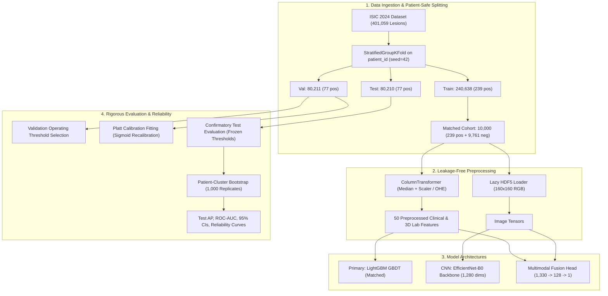

# SkinRisk Fusion: Multimodal Skin Lesion Risk Classification

[](https://www.python.org/downloads/release/python-3110/)
[](https://pytorch.org/)
[](https://opensource.org/licenses/MIT)
[]()

> **⚠️ NON-CLINICAL EDUCATIONAL RESEARCH DISCLAIMER**  
> **This project is strictly an educational research prototype.** It has NOT been certified by any regulatory agency (e.g., FDA, CE-mark), has NOT undergone clinical trials, and **MUST NOT** be used for clinical diagnosis, patient triage, or self-examination. Always consult a qualified dermatologist for skin concerns.

---

## 1. Project Title & Research Objective

**SkinRisk Fusion** is a multimodal deep learning research benchmark investigating whether fusing **2D dermoscopic image tensors** with **clinical and 3D geometric lesion metadata** provides a superior malignancy risk ranking signal for skin lesion screening compared to single-modality baselines.

The project evaluates:
1. **Metadata-Only Baseline:** LightGBM Gradient-Boosted Decision Trees on 50 clinical and 3D colorimetric features.
2. **Image-Only CNN Baseline:** EfficientNet-B0 transfer learning from ImageNet ($160 \times 160$ RGB input).
3. **Multimodal Fusion Model:** Neural concatenation of 1,280-dimensional CNN visual embeddings with 50-dimensional tabular metadata into an MLP risk-scoring head.

---

## 2. Problem Statement & Motivation

Malignant melanoma is among the deadliest forms of skin cancer, yet early identification dramatically increases survival rates. However, automated screening models face severe real-world challenges:
* **Extreme Class Imbalance:** In population-scale total-body photography (TBP) screenings, malignant lesions represent fewer than **1 in 1,000 lesions (~0.096% prevalence)**. Standard classification accuracy is meaningless.
* **Intra-Patient Correlation:** A single patient often presents with dozens of benign lesions and at most one or two malignancies. Random sample-level splitting leaks patient-specific appearance and demographics into test partitions, artificially inflating reported performance.
* **Modality Complementarity:** Pure image CNNs learn visual micro-morphology, borders, and pigment symmetry, but lack physical scale (lesion diameter in millimeters) and anatomic context. Tabular metadata captures macroscopic 3D geometry and delta colorimetry relative to surrounding skin, but ignores subtle visual patterns.

---

## 3. System Architecture



---

## 4. Dataset Source, Attribution & Licensing

* **Dataset:** [ISIC 2024 Challenge: Skin Cancer Detection with 3D-TBP](https://www.isic-archive.com/)
* **Attribution:** International Skin Imaging Collaboration (ISIC) and partner clinical institutions.
* **Licensing:** The ISIC dataset is distributed under Creative Commons licensing (CC-BY / CC-BY-NC). Usage in this repository is strictly academic and non-commercial.
* **Storage Format:** Local metadata stored in CSV (`train-metadata.csv`) and images in HDF5 archive (`train-image.hdf5`).

---

## 5. Dataset Composition & Severe Class Imbalance

| Partition | Total Records (% of Total) | Unique Patients | Malignant Lesions (`target=1`) | Benign Lesions (`target=0`) | Malignant Prevalence |
| :--- | :--- | :--- | :--- | :--- | :--- |
| **Train Split** | 240,638 (60.0%) | 625 | 239 | 240,399 | **0.0993%** |
| **Validation Split** | 80,211 (20.0%) | 209 | 77 | 80,134 | **0.0960%** |
| **Test Split (Held-Out)** | 80,210 (20.0%) | 208 | 77 | 80,133 | **0.0960%** |
| **Total Dataset** | **401,059** (100.0%) | **1,042** | **393** | **400,666** | **0.0980%** |

---

## 6. Model Descriptions

1. **Matched Metadata-Only Baseline (Primary Candidate):**
   * Pre-registered before test evaluation based on superior validation Average Precision.
   * LightGBM Gradient-Boosted Decision Trees (300 estimators, learning rate 0.05, 31 leaves).
   * Inputs: 30 numeric measurements (long diameter, area, Lab color contrast) + 4 categorical features (sex, anatomical site, camera modality, body region).
2. **Matched Image-Only CNN Baseline:**
   * EfficientNet-B0 pretrained on ImageNet.
   * Input resolution: $160 \times 160$ pixels RGB.
   * Trained with binary cross-entropy and positive class weighting (`pos_weight=20.0`).
3. **Multimodal Fusion Network:**
   * Image branch: EfficientNet-B0 feature extractor outputting 1,280-dimensional visual embeddings.
   * Metadata branch: 50 preprocessed clinical/geometric features.
   * Multimodal head: Concatenation layer ($1,330$ dimensions) followed by $\text{Linear}(1330 \to 128) \to \text{BatchNorm1d} \to \text{ReLU} \to \text{Dropout}(0.3) \to \text{Linear}(128 \to 1)$.
   * Evaluated under both unweighted and weighted loss formulations.

---

## 7. Patient-Grouped Splitting & Leakage Safeguards

* **Disjoint Grouping:** Splits were generated using `StratifiedGroupKFold(n_splits=5, seed=42)` grouped by `patient_id`. **Zero patient overlap** exists across train, validation, and test partitions.
* **Leakage-Safe Preprocessing:** The feature preprocessor was fitted strictly on the training cohort records. Validation and test sets were transformed without refitting.
* **Prohibited Features:** Identifiers (`isic_id`, `patient_id`, `lesion_id`), post-biopsy pathology diagnoses (`iddx_full`, `mel_thick_mm`), and automated scanner confidence scores were strictly excluded from model inputs.

---

## 8. Training & Evaluation Methodology

* **Hardware Target:** Optimized for local training on Apple Silicon M3 (8 GB unified memory) via PyTorch Metal Performance Shaders (`mps`).
* **Deterministic Matched Cohort:** To prevent memory exhaustion while preserving 100% of minority class signal, all matched models were trained on an identical $10,000$-sample cohort ($239$ malignant, $9,761$ benign; prevalence: $2.390\%$).
* **Lazy HDF5 Loading:** Images are decoded on-the-fly directly from HDF5 archive without loading the full 1.2 GB dataset into RAM.
* **Evaluation Metrics:** Evaluated primarily on **Average Precision (AP / PR-AUC)** and **ROC-AUC** (threshold-independent ranking), plus Precision, Recall, and F1 at pre-frozen validation decision thresholds.

---

## 9. Final Test & Validation Results

All candidate models were evaluated on the **identical 80,210-lesion held-out test partition** ($77$ malignant, $80,133$ benign) using **frozen checkpoints and thresholds**:

| Modality | Model Name | Checkpoint / Config | Test AP (PR-AUC) [95% CI] | Test ROC-AUC [95% CI] | Frozen Thresh | Test Prec | Test Rec | Test F1 | Test Confusion Matrix |
| :--- | :--- | :--- | :--- | :--- | :--- | :--- | :--- | :--- | :--- |
| **Metadata Only** | **Matched LightGBM (Primary)** | `Deterministic fit (seed=42)` | **0.06377** `[0.0321, 0.1365]` | **0.92480** `[0.8913, 0.9532]` | `0.3841` | 0.0732 | **0.2987** | **0.1177** | `TP=23, FP=291, TN=79842, FN=54` |
| **Metadata Only** | LightGBM (Platt Calibrated) | `Platt Scaled (fit on val)` | **0.06377** `[0.0321, 0.1365]` | **0.92480** `[0.8913, 0.9532]` | `0.0312` | 0.0708 | **0.2987** | **0.1144** | `TP=23, FP=302, TN=79831, FN=54` |
| **Image CNN Only** | EfficientNet-B0 (Matched pos=20) | `cnn_effnet_weighted.pt` | **0.00972** `[0.0052, 0.0204]` | **0.79225** `[0.7365, 0.8463]` | `0.9284` | 0.0476 | 0.0390 | **0.0429** | `TP=3, FP=60, TN=80073, FN=74` |
| **Multimodal Fusion** | Multimodal Net (Unweighted) | `fusion_unweighted.pt` | **0.03499** `[0.0126, 0.0953]` | **0.85727** `[0.8053, 0.9015]` | `0.5554` | **0.1290** | 0.0520 | **0.0741** | `TP=4, FP=27, TN=80106, FN=73` |
| **Multimodal Fusion** | Multimodal Net (Weighted pos=20) | `fusion_weighted.pt` | **0.06471** `[0.0170, 0.1401]` | **0.85176** `[0.7979, 0.9001]` | `0.9688` | 0.1250 | 0.1169 | **0.1208** | `TP=9, FP=63, TN=80070, FN=68` |

### Key Scientific Findings & Interpretation
1. **Metadata-Only Primary Model Generalization:** LightGBM generalized effectively from validation (AP = 0.05095) to test (AP = **0.06377**, ROC-AUC = **0.92480**), detecting 23 of 77 test malignancies.
2. **Multimodal vs. Metadata:** While Weighted Fusion achieved a slightly higher AP point estimate (0.06471 vs 0.06377), their 95% bootstrap confidence intervals heavily overlap. LightGBM achieved a significantly higher ROC-AUC (0.92480 vs 0.85176) and detected $2.5\times$ more true positive malignant lesions (23 vs 9) at its operating threshold.
3. **Multimodal vs. Image-Only CNN:** Multimodal Fusion achieved a **$3.6\times$ to $6.6\times$ uplift in Average Precision** over the standalone CNN (0.00972 $\to$ 0.06471) and lifted ROC-AUC from 0.792 to 0.852, confirming that clinical metadata is essential when interpreting total-body photography.
4. **Statistical Uncertainty:** Because the test set contains only 77 malignant lesions, small shifts in ranking for 2–3 patients alter the AP point estimate. We do not claim statistically significant superiority for the multimodal model.
5. **Probability Calibration:** Platt scaling reduced mean predicted probability from an inflated 0.49% to **0.108%** (aligning with 0.096% true prevalence) and improved test Brier score from 0.00292 to **0.00095**.

---

## 10. Environment Setup Instructions

The project uses Python 3.11 managed via `uv` or standard virtual environments:

```bash
# Clone the repository
git clone https://github.com/chinmay7980/skin_cancer_detection.git
cd skin_cancer_detection

# Create and activate virtual environment via uv
uv venv .venv --python 3.11
source .venv/bin/activate

# Install editable package and dependencies
uv pip install -e .
```

---

## 11. Configuring Local Dataset Paths

Dataset paths are defined in `config/default_config.yaml`. To configure your local dataset directory without committing private paths:

```yaml
data:
  raw_dir: "/path/to/isic-2024-challenge"
  train_metadata: "/path/to/isic-2024-challenge/train-metadata.csv"
  train_images_hdf5: "/path/to/isic-2024-challenge/train-image.hdf5"
```

---

## 12. Running Tests & Streamlit Demo

### Run Full Automated Test Suite (38 Tests)
```bash
.venv/bin/pytest tests/
```

### Launch Interactive Streamlit Application
```bash
.venv/bin/streamlit run app/streamlit_app.py
```
The application runs locally at `http://localhost:8501`, featuring:
* Interactive metadata form with calibrated vs. uncalibrated research risk scoring.
* Dermoscopic image upload and EfficientNet-B0 inference.
* Full multimodal neural fusion scoring.
* Comprehensive performance tables, PR curves, and reliability diagrams.

---

## 13. Model Artifacts & Reconstruction Instructions

Model checkpoints are stored locally under `checkpoints/` and excluded from Git to avoid large binary commits:
* `checkpoints/lgbm_matched_model.joblib`
* `checkpoints/metadata_preprocessor.joblib`
* `checkpoints/platt_calibrator.joblib`
* `checkpoints/cnn_efficientnet-b0_weighted_pos_20_best.pt`
* `checkpoints/multimodal_fusion_unweighted_best.pt`
* `checkpoints/multimodal_fusion_weighted_pos_20_best.pt`

To reproduce the matched training run and regenerate all checkpoints deterministically:
```bash
.venv/bin/python scripts/train_multimodal_fusion.py --epochs 2 --val-batch-size 64
.venv/bin/python scripts/evaluate_final_test.py --batch-size 64 --bootstraps 1000
```

---

## 14. Explicit Limitations & Future Work

1. **Dataset Scope:** The dataset is composed of 3D Total-Body Photography crops from specialized hospital systems, which differ in lighting, zoom, and resolution from consumer smartphone images.
2. **Limited Positive Evaluation Cases:** Even across 80,210 test lesions, only 77 are malignant. Expanding prospective evaluation cohorts is vital.
3. **Future Work:**
   * Exploring end-to-end backpropagation with unfreezing of topmost CNN feature blocks.
   * Investigating self-supervised vision transformer (ViT) foundation models (e.g. DINOv2 dermoscopy backbones).
   * Incorporating longitudinal change detection across serial lesions from the same patient.
