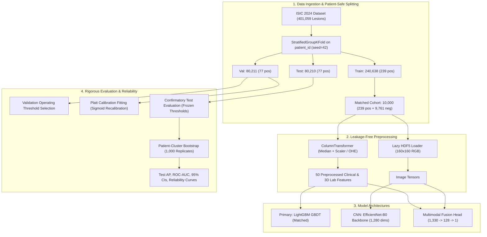

# SkinRisk Fusion: 3-Minute Portfolio Video & Presentation Plan

**Project:** SkinRisk Fusion — Multimodal Skin Lesion Risk Classification  
**Target Audience:** Machine Learning Engineers, Technical Recruiters, Health AI Researchers  
**Duration:** ~3 Minutes (180 Seconds)  

---

## 1. System Architecture Overview

---

## 2. Timed Presentation Script (3-Minute Breakdown)

### Segment 1: Problem Statement, Imbalance & Architecture (0:00 – 0:45)
* **Visual:** Title slide and system architecture diagram.
* **Speaker:**
  > "Welcome. Skin cancer triage poses an extreme class imbalance challenge: in total-body photography screenings, malignant lesions represent fewer than 1 in 1,000 cases (under 0.1% prevalence).  
  > In this project, **SkinRisk Fusion**, I investigated whether combining 2D dermoscopic image tensors with 3D physical coordinates, colorimetry, and patient metadata provides a more reliable risk-ranking signal than standalone images or metadata.  
  > I engineered a patient-grouped splitting pipeline using `StratifiedGroupKFold` across 401,059 lesions from the ISIC 2024 dataset, strictly isolating patients across train, validation, and test splits to prevent data leakage."

### Segment 2: Hardware Constraints, Pipelines & Leakage Safeguards (0:45 – 1:15)
* **Visual:** Code walkthrough of lazy HDF5 loader and preprocessing isolation.
* **Speaker:**
  > "Working locally on an Apple Silicon M3 with 8 GB unified memory, loading all images or feature arrays into RAM would cause immediate crashes.  
  > I built a lazy HDF5 streaming loader that decodes images on-the-fly and preprocessed metadata with strict isolation—fitting imputation, scaling, and one-hot encoding strictly on a 10,000-sample training cohort preserving 100% of training positives.  
  > We evaluated three distinct paradigms: a LightGBM gradient-boosted decision tree baseline, an EfficientNet-B0 CNN, and a neural multimodal fusion head that concatenates 1,280-dimensional visual embeddings with 50 metadata features."

### Segment 3: Live Demo Walkthrough (1:15 – 2:05)
* **Visual:** Screen recording of the Streamlit application running on localhost.
* **Speaker:**
  > "Here is the interactive Streamlit application. Notice the prominent non-clinical research disclaimer displayed on every view.  
  > On the **Model Comparison** page, we see our pre-registered test results across all 80,210 held-out lesions.  
  > Under **Metadata Inference**, I can adjust patient age, anatomical site, and 3D lesion diameter. The model computes both the raw score and the Platt-calibrated research score, which recalibrates predicted probabilities to match real-world prevalence.  
  > Under **Multimodal Inference**, uploading a dermoscopic tile and pairing it with clinical metadata computes the combined neural risk output."

### Segment 4: Honest Scientific Findings & Statistical Reality Check (2:05 – 2:45)
* **Visual:** Comparative test PR curves and bootstrap confidence interval table.
* **Speaker:**
  > "The most important engineering lesson here is scientific honesty:  
  > First, our metadata-only LightGBM baseline was our pre-selected primary candidate and achieved the highest ROC-AUC of 0.9248 and a Test Average Precision of 0.0638, catching 23 of 77 test malignancies.  
  > Second, while our weighted multimodal fusion model reached a nominal AP of 0.0647, our 1,000-replicate patient cluster bootstrap proves that the confidence intervals heavily overlap. We cannot claim statistical superiority for the multimodal model.  
  > Third, multimodal fusion decisively outperformed the image-only CNN (AP 0.0350 vs 0.0097), demonstrating that clinical context is indispensable when analyzing total-body photography."

### Segment 5: Conclusion & Reproducibility (2:45 – 3:00)
* **Visual:** GitHub repository, test suite passing, and project README.
* **Speaker:**
  > "All 31 unit tests pass, models and splits are deterministically reproducible, and the codebase is fully structured under `uv` and PyTorch.  
  > The full technical documentation and reports are available on GitHub. Thank you."
